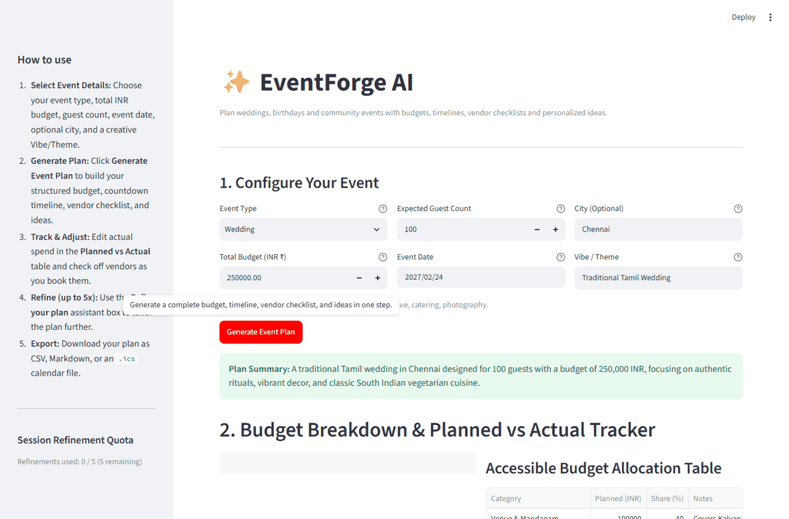
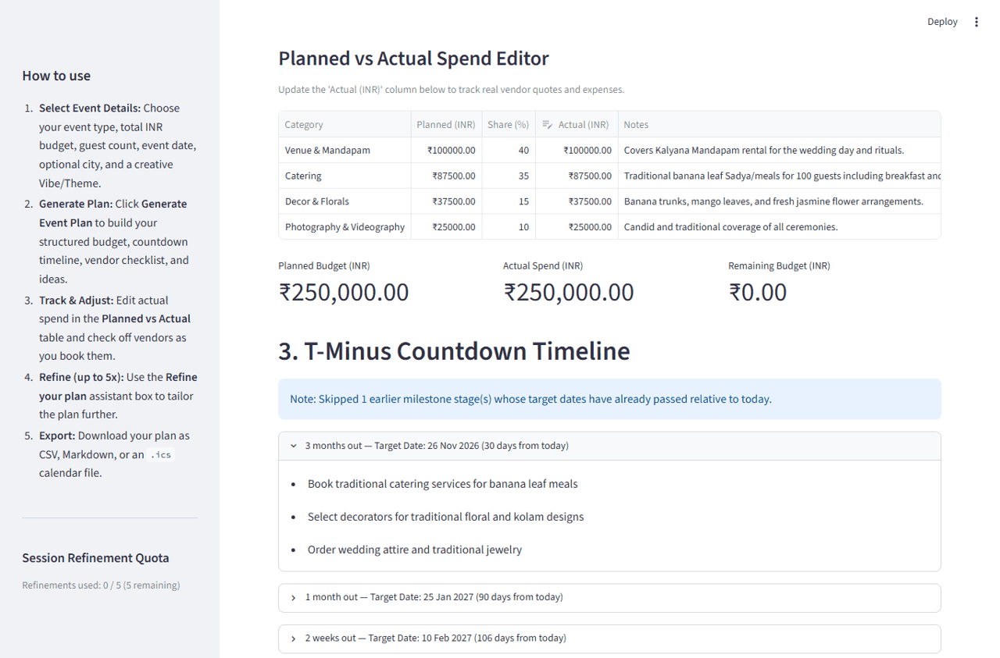
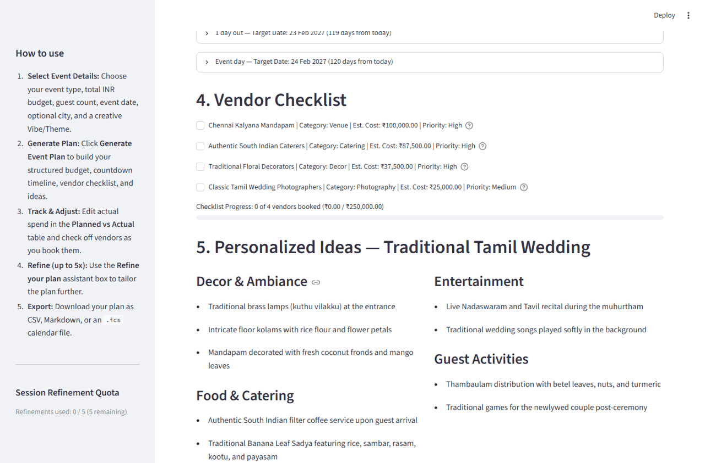

# ✨ EventForge AI

> **Problem Statement:**
> Create a GenAI-powered planning assistant that helps users organize weddings, birthdays, and community events with budgets, timelines, vendor checklists, and personalized ideas.

---

## Overview

**EventForge AI** is a Streamlit web application built with Python, Google Gemini (`google-genai`), Pydantic, Pandas, and Plotly. It serves as an end-to-end event planning assistant designed to help users organize weddings, birthdays, and community events with budgets, timelines, vendor checklists, and personalized ideas.

Whether connected to the Google Gemini API or running in offline fallback mode using built-in templates, EventForge AI generates a structured, validated plan in a single operation and keeps all interactive widgets (budget table edits, vendor checkboxes, chart interactions, and file exports) responsive without re-triggering API calls.

---

## Features by Event Type

### 1. Wedding
- **Domain Focus Areas:** Ceremonies, venue, catering, photography.
- **Tailored Outputs:** Mandap/hall allocations, multi-course catering planning, candid photography & videography checklists, ceremony officiant schedules, and culturally resonant decor and invitation wording (including Unicode scripts such as Tamil and Hindi).

### 2. Birthday
- **Domain Focus Areas:** Age group, entertainment, cake.
- **Tailored Outputs:** Multi-generational activity zones, custom cake & allergen-aware dessert station allocations, DJ/emcee scheduling, and theme-driven decor and party activities (e.g., `"Cyberpunk Birthday"`).

### 3. Community Event
- **Domain Focus Areas:** Volunteers, permits, sponsors, safety, accessibility, cleanup.
- **Tailored Outputs:** Municipal and loudspeaker permit milestones, volunteer shift coordination, sponsor booth logistics, first-aid and wheelchair-accessibility checklists, and zero-waste post-event cleanup allocations (e.g., `"Neighbourhood Diwali Fair"`).

### Core Capabilities Across All Event Types
- **Interactive Budget & Planned vs. Actual Tracker:** Validates that allocations sum to the total INR budget (within a 1% tolerance), auto-normalizes discrepancies with a clear warning, renders an Okabe-Ito colorblind-safe Plotly donut chart with an adjacent accessible data table, and provides an editable `st.data_editor` table that computes remaining budget and warns when actual spend exceeds the budget.
- **T-Minus Countdown Timeline:** Displays milestones (`"6 months out"` through `"Event day"`) inside expandable sections, computes exact calendar dates from the chosen event date, and automatically skips stages whose dates are already in the past.
- **Persistent Vendor Checklist:** Stores checkbox state in `st.session_state` with stable keys per vendor item, displaying category, estimated INR cost, and priority (`High`, `Medium`, `Low`) alongside a live completion progress bar without re-triggering the Gemini API.
- **Refine Your Plan Assistant:** Allows users to iteratively refine their plan in natural language (e.g., `"make it cheaper"`, `"add a kids section"`), sanitized via regex and capped at 5 refinements per session.
- **Resilient Offline Fallback:** Automatically loads and scales built-in JSON templates (`templates/wedding.json`, `templates/birthday.json`, `templates/community_event.json`) to the user's exact INR budget whenever `GOOGLE_API_KEY` is absent, times out, or encounters an error, displaying a `"Showing a template plan"` banner.
- **Multi-Format Exports:** One-click downloads for CSV (budget + vendor status), Markdown (complete plan), and RFC 5545 `.ics` iCalendar files (active timeline milestones).

---

## Screenshots

### 1. Event Configuration, Budget Chart & Accessible Table


### 2. T-Minus Countdown Timeline & Persistent Vendor Checklist


### 3. Personalized Ideas, Plan Refinement & Exports


---

## Text Architecture Diagram

```text
+-------------------------------------------------------------------+
|                        Streamlit UI (app.py)                      |
|  - st.set_page_config (first Streamlit call)                      |
|  - Sidebar "How to use" + Session Refinement Counter (max 5)      |
|  - Event Inputs -> Budget Editor -> Timeline -> Vendors -> Export |
+-----------------+-------------------------------+-----------------+
                  |                               |
                  v                               v
+-----------------------------------+   +---------------------------+
|   services/gemini_client.py       |   |   services/planner.py     |
|  - @st.cache_data(ttl=3600)       |   |  - @st.cache_data(ttl=3600|
|  - Delimited <USER_DATA> prompt   |   |  - Budget 1% validation & |
|  - response_mime_type=json        |   |    auto-normalization     |
|  - Timeout + 1 retry w/ backoff   |   |  - T-minus date math &    |
+--------+-----------------+--------+   |    past-stage filtering   |
         |                 |            |  - CSV, MD, .ics exports  |
         v                 v            +---------------------------+
+------------------+  +---------------------------------------------+
|services/         |  |          services/fallback.py               |
|validators.py     |  |  - Loads templates/{wedding,birthday,       |
|- sanitize_input()|  |    community_event}.json                    |
|- Pydantic models |  |  - Scales allocations & vendor costs to INR |
|  (EventPlan)     |  +---------------------------------------------+
+------------------+
```

---

## Evaluation Alignment

| Criterion | How this repo addresses it | File(s) |
| :--- | :--- | :--- |
| **Code Quality** | Modular separation of UI and services; full type hints and docstrings; functions kept concise (<40 lines); named constants in `config.py`; structured `logging` instead of `print`. | `app.py`, `config.py`, `services/*.py` |
| **Security** | Regex `sanitize_input()` strips `<script>` tags, `< >`, control chars, and SQL comment tokens while allowing Unicode (Tamil/Hindi) up to 100 chars; user inputs isolated inside `<USER_DATA>` tags out of `SYSTEM_INSTRUCTION`; strict Pydantic validation; `GOOGLE_API_KEY` read via `os.getenv` / `st.secrets`; zero `unsafe_allow_html`. | `services/validators.py`, `services/gemini_client.py`, `.gitignore`, `.env.example` |
| **Efficiency** | `@st.cache_data(ttl=3600)` on `generate_event_plan`, `build_budget_dataframe`, and `compute_active_timeline` using hashable tuple inputs; single API call per plan with `response_mime_type="application/json"` and `response_schema=EventPlan`; timeout + 1 backoff retry. | `services/gemini_client.py`, `services/planner.py`, `config.py` |
| **Testing** | 33 automated `pytest` tests using `unittest.mock.patch` for offline execution; covers `sanitize_input`, Pydantic models, budget normalization, timeline date math, exports, fallback templates, API retry/failure paths, and `AppTest` UI flows in both modes (96% coverage). | `tests/conftest.py`, `tests/test_*.py`, `pytest.ini` |
| **Accessibility** | `st.set_page_config` called immediately after imports; descriptive labels and `help=` text on all widgets; Okabe-Ito colorblind-safe palette (`COLORBLIND_SAFE_PALETTE`); `st.caption()` + accessible `st.dataframe` beside charts; text priority indicators (`High`, `Medium`, `Low`); sidebar `"How to use"`. | `app.py`, `config.py` |
| **Problem Statement Alignment** | Exact problem statement wording reused in UI heading and README; supports Wedding, Birthday, and Community Event workflows with INR budgets, T-minus timelines, persistent vendor checklists, theme ideas, 5x refinement cap, offline fallback, and CSV/MD/ICS exports. | `app.py`, `config.py`, `services/*.py`, `templates/*.json`, `README.md` |

---

## Setup, Run, and Test Commands

### 1. Prerequisites & Installation
```bash
# Clone or navigate to the project directory
cd EventForge-AI

# (Optional) Create and activate a virtual environment
python -m venv .venv
# Windows PowerShell:
.venv\Scripts\Activate.ps1
# macOS / Linux:
source .venv/bin/activate

# Install pinned dependencies
pip install -r requirements.txt
```

### 2. Environment Configuration
Copy `.env.example` to `.env` and add your Gemini API key (optional — if omitted, the app runs seamlessly in offline template mode):
```bash
cp .env.example .env
```
Edit `.env`:
```env
GOOGLE_API_KEY=your_actual_api_key_here
GEMINI_MODEL=gemini-3.5-flash-lite
```

### 3. Run the Application
```bash
# Run with API key (configured in .env or environment)
streamlit run app.py

# Run in offline fallback mode (without an API key)
GOOGLE_API_KEY="" streamlit run app.py
```

### 4. Run the Automated Test Suite
```bash
# Run all unit and integration tests
pytest

# Run with coverage report on services/
pytest --cov=services --cov-report=term-missing
```

---

## Limitations and Future Work

1. **Session-Scoped Persistence:** Plans, vendor checkbox states, and actual spend edits are stored in `st.session_state` for the active browser session and exported via CSV/Markdown/ICS. Future work could add optional SQLite or cloud database persistence for multi-user collaboration.
2. **Single-Currency Display:** Budgets default to Indian Rupees (`INR` / `₹`). Future iterations could add live multi-currency conversion for destination events.
3. **Static Vendor Estimates in Offline Mode:** When running without a Gemini API key, vendor cost estimates are linearly scaled from curated baseline templates rather than dynamically queried from local city vendor directories.
4. **Refinement Cap per Session:** To prevent runaway token usage, interactive refinements are capped at 5 per session (`MAX_REFINEMENTS = 5`).
